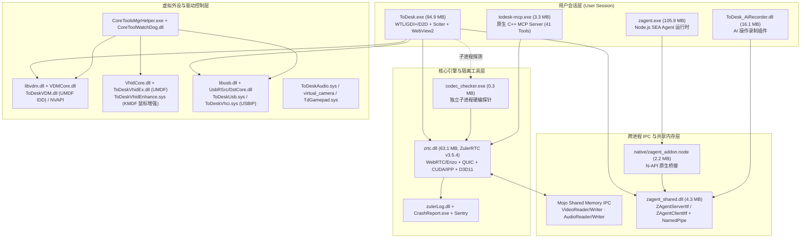
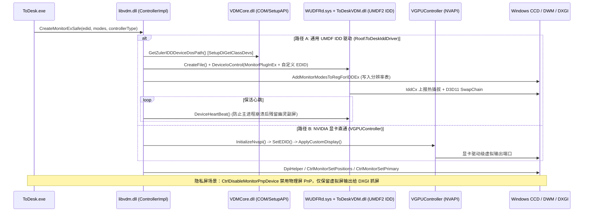
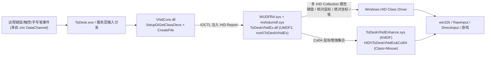
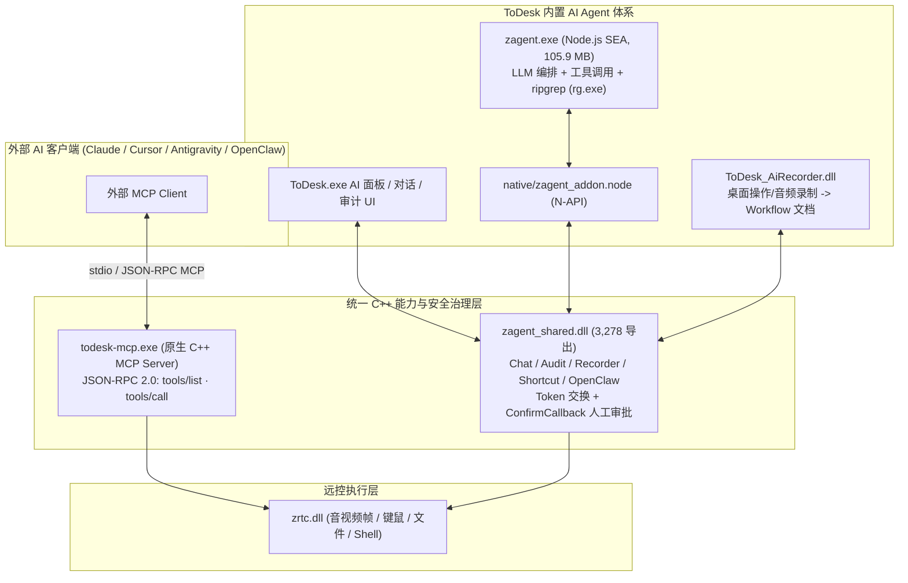

# ToDesk（Windows v5.3.1.0）深度架构拆解与 Clean-Room 远控落地设计方案

> **分析声明与边界**：本文档基于当前工作区 [toDesk/](../toDesk) 与 [ToDesk-analysis/](../ToDesk-analysis) 目录下的离线静态证据（PE 导入/导出符号表、PE 节表、驱动 `.inf` 清单、版本号元数据及公开字面量标记）整理完成，遵循 REA 证据优先原则，**严格区分已观测事实与未观测边界**。所有 Clean-Room 方案设计均基于公开操作系统 API（DXGI / WGC / D3D11 / IddCx / VHF / WebRTC / QUIC / MCP JSON-RPC 2.0）独立构建，不涉及任何私有协议破解、授权绕过或代码复用。

---

## 目录

1. [全局进程与模块拓扑](#1-全局进程与模块拓扑)
2. [`zrtc.dll` 音视频与低延迟渲染架构](#2-zrtcdll-音视频与低延迟渲染架构)
3. [虚拟显示器（IDD）+ 虚拟键鼠（VHID）驱动交互链路](#3-虚拟显示器idd-虚拟键鼠vhid-驱动交互链路)
4. [`zagent.exe` + `todesk-mcp.exe` 的 AI Agent / MCP 工具体系设计](#4-zagentexe--todesk-mcpexe-的-ai-agent--mcp-工具体系设计)
5. [可直接落地的 Clean-Room 最小可行远控（MVP）架构方案](#5-可直接落地的-clean-room-最小可行远控mvp架构方案)
6. [静态分析证据索引与未观测边界](#6-静态分析证据索引与未观测边界)

---

## 1. 全局进程与模块拓扑

ToDesk Windows 客户端（v5.3.1.0）并非单体应用，而是围绕**权限隔离、故障隔离、跨进程零拷贝媒体传输、驱动外设虚拟化与 AI Agent 编排**拆分出的多进程架构：



### 关键架构设计意图
1. **高危能力子进程隔离**：显卡编解码探测放在短命子进程 `codec_checker.exe`（仅调用 `zuler::checkOneCodec`），避免劣质显卡驱动在初始化 NVENC/AMF/MFX 时直接导致主进程闪退。
2. **高权限采集与用户态 UI 解耦**：`zrtc.dll` 内置了基于 **Chromium Mojo** 风格的共享内存读写通道（`VideoReader` / `VideoWriter` / `AudioReader` / `AudioWriter`），用于将 Session 0 服务进程或特权采集进程抓到的音视频帧低开销传递给 UI/编码进程。
3. **AI 运行时与主客户端解耦**：Node.js SEA 打包的 `zagent.exe` 与原生 `todesk-mcp.exe` 独立进程运行，通过 `zagent_shared.dll` 和 `zrtc.dll` 复用底层远控能力，而不污染主桌面程序的稳定性。

---

## 2. `zrtc.dll` 音视频与低延迟渲染架构

`zrtc.dll`（ZulerRTC v3.5.4.1030，导出 3,204 个符号，统一命名空间 `zuler::`）是 ToDesk 远控体验的绝对核心。

### 2.1 端到端数据流水线

```mermaid
flowchart LR
    subgraph CAP["1. 采集层 (Capture)"]
        DXGI["DXGI Desktop Duplication<br/>DirtyRects + MoveRects + CursorShape"]
        WGC["Windows.Graphics.Capture"]
        GDI["GDI BitBlt 兜底"]
        WASAPI["WASAPI 音频采集 + EchoCanceller"]
    end

    subgraph PROC["2. 帧封装与前处理"]
        VF["VideoFrameItf<br/>updateRect / cursorPos / bitDepth / sharpen"]
        GPU["CUDA Fatbin + Intel IPP + libyuv<br/>色彩空间转换 / 缩放 / 锐化"]
    end

    subgraph ENC["3. 编码与复合帧层"]
        HW["硬编: NVENC / AMF / Intel MFX<br/>(失败自动回退 SW)"]
        SW["软编: x264 / libavcodec / VP8 / VP9 / AV1"]
        CMP["Compound 复合编码<br/>有损动态流 + 无损静态补帧"]
    end

    subgraph NET["4. 传输与房间层 (Erizo + QUIC)"]
        RTP["RTP/SRTP + DTLS + ICE/STUN/TURN<br/>Cursor 走 RTP Header Ext"]
        SFU["ErizoRoomItf<br/>HotMuxRoom + SFU E2EE"]
        DC["DataChannelItf (SCTP/QUIC)<br/>剪贴板 / 文件 / 磁盘 / USB"]
    end

    subgraph REN["5. 解码与低延迟渲染层"]
        DEC["Compound 解码 + 缓存帧合并<br/>lossy_done -> lossless_done"]
        D3D["RenderingItf / MultiRenderD3DItf<br/>D3D11 + D2D1 + DwmFlush (OpenGL 兜底)"]
    end

    CAP --> VF --> GPU --> ENC --> NET --> DEC --> D3D
```



### 2.2 分阶段核心接口与关键机制拆解

#### 阶段一：采集与跨进程零拷贝传递
- **采集源抽象**：
  - `DesktopSourceItf`（`getSources`、`getWindowSources`、`getSourceTypeID`）：支持全屏与单窗口源枚举。
  - `CameraSourceItf` / `SoundCardSourceItf`：统一抽象摄像头与系统环回声卡采集。
  - Windows 抓屏策略呈现典型的**三级梯度**：
    1. **首选 `IDXGIOutputDuplication`**（`DuplicateOutput` / `AcquireNextFrame`）：直接获取 GPU 显存纹理，同时提取 `MoveRects`（窗口拖拽位移块）与 `DirtyRects`（局部脏区域），以及 `GetFramePointerShape`（光标位图形状），大幅减少无效像素编码。
    2. **次选 `Windows.Graphics.Capture`（WGC）**：用于现代窗口捕获或 DXGI 受限场景。
    3. **兜底 `GDI BitBlt`**：用于老旧驱动、安全桌面切换失败或特殊远程会话。
- **帧对象元数据（`VideoFrameItf` 导出方法证据）**：
  - 时间与标识：`captureTimestamp`、`pictureID`、`capturerType`、`captureStatus`、`frameKeyInfo`。
  - 远控专属元信息：`hasUpdateRect` / `setUpdateRect`（脏区矩形）、`hasCursorPosition` / `cursorPosition`（光标坐标）、`originFrameSize`（原始分辨率，支持缩放对齐）、`bitDepth`（支持 8-bit/10-bit 色彩深度）、`sharpenMode` / `sharpenAlpha`（画质锐化参数）。
- **跨进程共享内存 IPC（Mojo Buffer）**：
  - 导出类 `VideoReader` / `VideoWriter` 与 `AudioReader` / `AudioWriter` 包含 `allocVideoItem`、`onMojoNewBufferCallback`、`onMojoBufferReadyCallback`、`onMojoDisconnectCallback`。
  - 这说明采集端与编码/UI 端通过共享内存 RingBuffer 传递帧数据，避免走命名管道拷贝大尺寸未压缩图像。

#### 阶段二：前处理、硬/软编码与复合帧（Compound Frame）
- **异构计算内嵌**：
  - PE 节表直接嵌入了 **NVIDIA CUDA Fatbinary**（`.nvFatBi`、`.nv_fatb`、`__nv_mod`、`__nv_rel`，并导出 `NvOptimusEnablementCuda` 强制双显卡笔记本优先启用独显）以及 **Intel IPP**（`IPPCODE`、`IPPDATA`），配合 `libyuv` 处理 BGRA ↔ NV12/I420/YUV444 色彩转换与 `ImageProcessingModuleItf` 图像增强。
- **编解码调度与自愈**：
  - 硬件路径：`NvEncodeAPICreateInstance`（NVIDIA NVENC）、`AMFInit`（AMD AMF）、`MFXInit`（Intel QSV/MediaSDK），以及跨平台预留的 `VideoToolbox`（macOS）。
  - 软件路径：静态链接 `x264`、`FFmpeg/libavcodec`，支持 `H.264 / H.265(HEVC) / AV1 / VP8 / VP9`。
  - 自动降级策略（证据见 [windows-client-display.json](../ToDesk-analysis/windows-client-display.json)）：`CompositeVideoEncoder` 支持录制强制关键帧（`Forcing keyframe for recording`），并在硬编初始化失败时触发 `switch to SW and retry once`。
- **复合帧分层解码（远控文字清晰度的关键）**：
  - 静态证据明确出现 `[COMPOUND_DECODE_FRAME] phase=lossy_done`、`phase=lossless_done`、`start merge cache frame`、`merge cache frame time cost:` 与 `Cache decoder failed, request key frame`。
  - **工作机理**：普通视频编码（YUV420 有损）在远程看代码/表格时文字边缘会发虚发糊；复合帧管线将动态画面先以有损流快速出帧（`lossy_done`），再对静止或高对比度文字脏区叠加无损/高保真增量层（`lossless_done`）并与本地缓存帧合并（`merge cache frame`），若缓存帧损坏则立刻请求关键帧（PLI/FIR）重建状态。

#### 阶段三：传输协议栈与房间复用（Erizo + QUIC）
- **房间模型（`ErizoClientItf` / `ErizoRoomItf` / `ErizoConnectionItf`）**：
  - 基于 Licode/Erizo 概念演化，提供三种建房模式：`createRoomWithReportConfig`、`createMuxRoomWithReportConfig`、`createHotMuxRoomWithReportConfig`（**热备多路复用房间**，用于弱网切换或 P2P ↔ 中继无缝热切）。
  - 端到端加密开关：`configureSfuE2ee` / `downgradeSfuE2ee`，即便流量经过 SFU 服务器中转，媒体载荷仍可做端到端加密。
  - 网络偏好与路由介入：`setIcePreferredNetwork`、`setEcPreferredNetwork`、`NetworkEnvironmentMonitorItf`，配合 `NetworkRuleProvider`（`deleteFirewallRules` / `deleteRouteRules`）。
- **光标低延迟通道**：
  - 证据字符串 `urn:ietf:params:rtp-hdrext:sdes:cursor-position` 表明光标位置被写入 **RTP 扩展头**随包附带，无需等待整帧视频编解码完毕即可在客户端本地立即刷新鼠标位置。
- **多业务 DataChannel 复用**：
  - 通过 `DataChannelItf`（`setSendRate`、`setSendV2`）在同一连接下复用多个虚拟业务子系统：
    - `BClipboardItf`（双向剪贴板同步）
    - `BFileSystemClientItf` / `BFileSystemServerItf`（文件管理与断点续传）
    - `BDriveRedirectClientItf` / `BDriveRedirectServerItf`（本地磁盘远程映射）
    - `BUsbRedirClientItf` / `BUsbRedirServerItf`（USB over IP 隧道）
    - `MP4RecorderItf`（本地会话录像，且有 `RecoverMP4Files` 异常断电修复接口）

#### 阶段四：低延迟渲染（`RenderingItf`）
- 导出 `CreateRenderingModule`、`RenderD3DItf`、`MultiRenderD3DItf`（多屏同步渲染）、`RenderMetalItf` / `MultiRenderMetalItf`（跨平台抽象）以及核心提交接口 `RenderToSurface` / `Present`。
- Windows 端以 **D3D11 + Direct2D/DWrite** 为主渲染后端，调用 `dwmapi.dll!DwmFlush` 与桌面窗口管理器（DWM）VSync 节拍对齐减少撕裂与排队延迟；同时延迟加载（delay-import）`OPENGL32.dll` 作为低版本或特殊环境下的渲染兜底。

---

## 3. 虚拟显示器（IDD）+ 虚拟键鼠（VHID）驱动交互链路

远控软件之所以比普通录屏工具复杂得多，核心在于**无显示器主机（Headless）、隐私屏（黑屏防偷窥）、多屏扩展、UAC/锁屏/游戏场景键鼠穿透**都需要操作系统级虚拟设备驱动。

### 3.1 虚拟显示器（IDD + NVAPI 双引擎）交互链路



#### 关键工程细节（全部源自 `libvdm.dll` / `VDMCore.dll` / `.inf` 导出证据）
1. **双引擎策略**：
   - `IDDController` 对接自研 UMDF 2.0 间接显示驱动 `ToDeskVDM.dll`（`Root\ToDeskIddDriver`，由系统反射器 `WUDFRd.sys` 加载，兼容 Win10/Win11，不进内核态故不会引发蓝屏 BSOD）；旧版目录 `drivers/tdscreen/tdIdd.dll` 保留兼容。
   - `VGPUController` 封装了 `InitializeNvapi` / `LoadCustomDisplay` / `ApplyCustomDisplay` / `SetEDID`，在支持 NVAPI 的 NVIDIA 环境下可直接走显卡级虚拟屏（性能与游戏兼容性更好）。
2. **动态 EDID 合成与分辨率锁定**：
   - `BuildDefaultIddEdidForPlugInEx` 根据控制端屏幕尺寸动态构造 EDID，使被控端系统“以为”接入了一台与主控端分辨率完全一致的物理显示器。
   - `CtrlLockMonitorMode` / `CtrlHideModes` / `DpiHelper::SetDPIScaling` 用于同步 DPI 缩放、设置主副屏坐标拓扑（`CtrlMonitorSetPositions`）。
3. **心跳防幽灵屏（极其关键的生产经验）**：
   - `IDDController::DeviceHeartBeat` / `VDM::SendHeartBeat` 周期性向 `ToDeskVDM.dll` 发送心跳；一旦 `ToDesk.exe` 异常崩溃或被强杀，驱动层心跳超时自动 `MonitorPlugOut`，避免用户桌面永远卡在一个看不见的虚拟屏幕上无法找回窗口。
4. **隐私屏原理线索**：
   - `libvdm.dll` 导出 `CtrlDisableMonitorPnpDevice` / `CtrlEnableMonitorPnpDevice`，配合虚拟屏激活，可在远程连接期间将物理显示器置为禁用/关闭状态，而远程桌面继续采集虚拟 IDD 屏幕的画面。

### 3.2 虚拟键鼠（VHID + 内核增强过滤）交互链路



#### 关键工程细节（源自 `drivers/vhid` 与 `drivers/vHIDEx` 清单证据）
1. **为什么不用纯 `SendInput`**：Windows 用户态 `SendInput` 会携带 `LLMHF_INJECTED` 标志，会被 UIPI（跨权限 UAC 弹窗）、安全桌面（Ctrl+Alt+Del）、部分网银控件及反作弊/3D 游戏直接丢弃。
2. **UMDF 虚拟 HID 底座**：`ToDeskVhidEx.dll`（及旧版 `TodeskVhid.dll`）通过 `WUDFRd.sys` + `mshidumdf.sys` 注册为系统级 `HIDClass` 设备（`root\ToDeskVhidEx`），向 Windows 注入标准 HID 报告描述符。
3. **多 Collection + 内核鼠标增强分层**：从 [ToDeskVhidEnhance.inf](../toDesk/drivers/vHIDEx/ToDeskVhidEnhance.inf) 可观测到硬件 ID `HID\ToDeskVhidEx&Col04`（`Class=Mouse`），说明 `ToDeskVhidEx` 暴露了多个 HID 顶层集合（例如键盘、绝对坐标指针、相对坐标指针、触控/手写笔等），并专门针对第 4 个鼠标集合挂接了轻量级内核驱动 `ToDeskVhidEnhance.sys`（仅 26 KB），用来解决 3D 游戏 FPS 视角锁定（相对位移 `RawInput`）、指针加速曲线及系统级鼠标过滤问题。
4. **驱动安装与看门狗**：`CoreToolsMgrHelper.exe` + `WatchDog/CoreToolWatchDog.dll` 负责调用 `SetupAPI`/`CFGMGR32`/`devcon.exe` 完成静默安装、异常状态检测与服务拉起。

---

## 4. `zagent.exe` + `todesk-mcp.exe` 的 AI Agent / MCP 工具体系设计

v5.3.1.0 最具前瞻性的演进是把“远程桌面软件”升级为了**面向 AI 的远程 Computer-Use 与运维执行平面**，采用了清晰的**双入口架构**：



### 4.1 内部 Agent 运行时：`zagent.exe` + `zagent_shared.dll`
1. **单文件 Node.js 运行时（`NODE_SEA_BLOB`）**：
   - `zagent.exe`（描述为 `ZTerm Node Agent`）将整个 Node.js/V8 运行时与 JS/TS Agent 编排逻辑打包为单可执行文件，并通过 N-API 原生扩展 `zagent_addon.node` 双向调用 `zagent_shared.dll`。
   - 配套随包分发 `native/vendor/rg.exe`（ripgrep），赋予本地 Agent 高速代码/日志搜索能力。
2. **六大核心域管理器（`zagent_shared.dll` 导出接口证据）**：
   - **对话会话域**（`ChatSessionManagerItf` / `ChatResponseStreamItf`）：管理多轮对话与流式输出（`ChatStreamChunk`）及附件（`Attachment`）。
   - **审计与人工确认域**（`AuditSessionManagerItf` / `AuditReport` / `ZAgentGetAuditFingerprint` / `ConfirmCallbackItf`）：AI 对远程主机执行高危操作前触发人工确认回调，并全程生成带指纹的审计报告。
   - **录制转工作流域**（`RecorderManagerItf` / `RecorderWorkflowDocItf` + `ToDesk_AiRecorder.dll`）：录制人类操作桌面与语音讲解，通过 `SetRecorderClickDescriptionOptimizationEnabled` 等优化步骤沉淀为结构化工作流文档（`RecorderWorkflowDocEntry`）。
   - **快捷指令/配方回放域**（`ShortcutManagerItf` / `ShortcutRecipeItf` / `ShortcutExecutionItf`）：将工作流编译/保存为可重复执行的自动化配方（Recipe）。
   - **生态互操作域**（`OpenClawManagerItf` / `CreateZAgentMCPServer`）：原生对接 OpenClaw 生态及内置 MCP Server。
   - **动态短时鉴权域**（`AccountObserverItf::OnMcpTokenUpdated` / `ExchangedTokenObserverItf` / `generateMcpToken`）：通过主程序动态签发和轮换短期交换 Token / MCP Token，避免 AI 进程长期持有用户主凭据。

### 4.2 独立标准 MCP Server：`todesk-mcp.exe`
`todesk-mcp.exe` 是一个轻量级（3.29 MB）的原生 C++ MCP Server，直接链接 `zrtc.dll`，通过 JSON-RPC 2.0 暴露了 **8 大 Schema 分组、共 41 个工具**（资源 URI 位于 `todesk://schema/tools/*.json`）：

| Schema 分组 | 暴露的工具列表（已观测静态证据） | 典型 AI 场景 |
| :--- | :--- | :--- |
| **`session_tools.json`** | `todesk_connect`、`todesk_disconnect`、`todesk_get_active_sessions`、`todesk_connect_device`、`todesk_disconnect_device` | 建立/断开与指定设备的远控会话 |
| **`device_tools.json`** | `todesk_list_devices`、`todesk_check_device_status`、`todesk_tag_device`、`todesk_subscribe_device_events` | 发现设备列表、查在线状态、打标签与订阅上下线事件 |
| **`gui_tools.json`** | `todesk_gui_screenshot`、`todesk_gui_screen_info`、`todesk_gui_click`、`todesk_gui_move`、`todesk_gui_drag`、`todesk_gui_type`、`todesk_gui_key`、`todesk_gui_hotkey`、`todesk_gui_scroll`、`todesk_gui_wait`、`todesk_gui_screen_lock`、`todesk_gui_screen_unlock`、`todesk_gui_screen_lock_status` | 标准 VLM **Computer Use** 闭环（截屏 → 视觉定位 → 点击/输入/快捷键/锁屏控制） |
| **`remote_control_tools.json`** | `todesk_send_mouse_event`、`todesk_send_keyboard_event`、`todesk_take_screenshot` | 底层原子级输入注入与截屏 |
| **`file_tools.json`** | `todesk_file_upload`、`todesk_file_download`、`todesk_list_remote_directory`、`todesk_get_transfer_status`、`todesk_cancel_transfer` | 跨机文件分发、目录浏览与异步传输进度查询 |
| **`command_tools.json`** | `todesk_exec_command`、`todesk_exec_preset_script`、`todesk_list_preset_scripts` | 远程命令执行与白名单预设运维脚本调用 |
| **`record_tools.json`** | `todesk_record_start_capture`、`todesk_record_stop_capture`、`todesk_record_get_desktop_state`、`todesk_record_audio_start/pause/resume/stop_capture` | 配合 AI 录屏采集桌面状态与分段音频 |
| **`notify_tools.json`** | `todesk_send_notification` | 向远端或本地用户推送任务进度/告警通知 |

> **设计亮点总结**：将**高阶语义化 GUI 工具**（`todesk_gui_click(clicks=2)` / `todesk_gui_hotkey`）与**底层命令/文件工具**融合在同一个 MCP Server 中，使 AI 既能走高效无 UI 的 `exec_command` + `file_upload`，遇到无 CLI 的桌面软件又能无缝切换到 `gui_screenshot` + `gui_click` 视觉操作。

---

## 5. 可直接落地的 Clean-Room 最小可行远控（MVP）架构方案

面向你当前目录 `copyToDesk` 的工程目标，下面给出一个**100% 开源合规、模块边界清晰、可在 4~6 周内跑通端到端 60fps 低延迟 + AI MCP 控制**的 Clean-Room 最小可行架构方案。

### 5.1 技术栈选型（避开重型历史包袱）

| 模块 | 推荐 Clean-Room 选型 | 选型理由（对比商业重型栈） |
| :--- | :--- | :--- |
| **核心引擎语言** | **Rust**（或 C++20） | 内存安全、易于封装 Windows COM/DXGI/FFmpeg/WebRTC，跨平台编译链路统一 |
| **桌面 UI 壳** | **Tauri 2（WebView2 + Rust）** 或 **Qt6 / Slint** | 复刻 ToDesk“轻量原生壳 + Web UI”思路，安装包 < 15 MB，开发效率远高于手写 WTL/Sciter |
| **屏幕采集 (Win)** | `IDXGIOutputDuplication`（首选）+ `Windows.Graphics.Capture`（次选） | 零拷贝拿 `ID3D11Texture2D` + 脏矩形 + 光标形状，微软官方 API |
| **色彩转换与编码** | **D3D11 Compute Shader (BGRA→NV12)** + **FFmpeg / NVIDIA Video Codec SDK / Media Foundation** | 避免强绑定 CUDA Fatbin 导致体积暴涨；D3D11 Shader 兼容 N/A/I 三家显卡，硬编失败回退 OpenH264 / x264 |
| **音视频与传输层** | **WebRTC（`libdatachannel` 或 `webrtc-rs`）** 或 **QUIC（`quinn` / `msquic`）** | MVP 强烈推荐 **QUIC + 自定义轻帧头** 或 **libdatachannel (ICE/TURN/DTLS/SRTP/SCTP)**，天然搞定 NAT 穿透与加密 |
| **信令与中继服务** | **Go / Rust 信令服（WebSocket）+ `coturn`（STUN/TURN）** | 标准协议栈，单台 2C4G 云主机即可支撑数百并发打洞与中继 |
| **解码与渲染** | **D3D11VA / DXVA2 硬解 → D3D11 SwapChain (`DXGI_SWAP_EFFECT_FLIP_DISCARD`)** | 纹理直出不上 CPU，配合 `DwmFlush` / `WaitableObject` 压低渲染排队到 1 帧以内 |
| **输入注入 (MVP→进阶)** | MVP：`SendInput`（系统服务提权运行）<br/>进阶：**Windows VHF (Virtual HID Framework)** 开源驱动 | MVP 先跑通服务提权注入；进阶直接用微软官方 WDK **VHF** 框架，比手写 `mshidumdf` 简单一个量级 |
| **虚拟显示器 (进阶)** | 微软官方 WDK **IddCx (Indirect Display Driver) Sample** 改造 | 参考开源生态（如 Virtual-Display-Driver / Parsec VDD 思路），加上**心跳超时自动拔出**机制 |
| **AI MCP Server** | 独立二进制 `copytodesk-mcp`（Rust `rmcp` 或 TypeScript `@modelcontextprotocol/sdk`） | 通过本地 Unix Socket / Named Pipe 复用核心会话，暴露精简版 10~15 个核心工具 |

### 5.2 Clean-Room 推荐仓库目录结构

```text
copyToDesk/
├── crates/ (或 src/)
│   ├── core-protocol/        # Protobuf/Bincode 帧头、输入事件、控制信令、光标扩展包定义
│   ├── core-capture/         # DXGI Desktop Duplication + WGC + WASAPI + 脏区/光标采集
│   ├── core-codec/           # D3D11 色彩转换 + NVENC/AMF/QSV/SW 编码 + 独立 codec-probe 子进程
│   ├── core-transport/       # ICE/STUN/TURN + QUIC/WebRTC 通道 + 多路复用 (Video/Audio/Input/File)
│   ├── core-render/          # D3D11VA 硬解 + D3D11 渲染 + 本地硬件光标叠加
│   ├── core-input/           # 键鼠/剪贴板抽象层 (MVP: Privileged SendInput; Phase2: VHF HID)
│   ├── core-vdisplay/        # (Phase2) IddCx UMDF 控制器 + EDID 生成 + 心跳保活
│   ├── host-service/         # Windows Service (Session 0 守护 + 提权采集/注入 + 共享内存 IPC)
│   ├── desktop-app/          # Tauri 2 控制端/被控端统一客户端 UI
│   └── mcp-server/           # 独立 MCP Server (stdio/SSE JSON-RPC 2.0 -> 本地 NamedPipe)
├── server/
│   ├── signaling/            # Go/Rust WebSocket 信令、设备在线表、临时 Session Token 签发
│   └── turn/                 # coturn 配置 (Docker Compose 一键部署)
└── drivers/                  # (Phase2) WDK IddCx 虚拟显示器 + VHF 虚拟键鼠工程
```

### 5.3 核心接口与协议设计（Clean-Room 精简抽象）

#### 1) 视频帧与光标解耦包格式
```rust
pub struct CapturedFrame {
    pub seq: u64,
    pub capture_ts_us: u64,
    pub width: u32,
    pub height: u32,
    pub dirty_rects: Vec<Rect>,        // 仅用于编码器 ROI/跳帧决策
    pub gpu_texture: Option<TextureHandle>, // 优先显存句柄，避免 CPU 回读
}

pub struct CursorPacket {              // 独立高优通道发送，不等待视频帧
    pub x: i32,
    pub y: i32,
    pub visible: bool,
    pub shape_hash: u64,               // 形状未变时不重传位图
    pub shape_rgba: Option<Vec<u8>>,
}
```

#### 2) 传输层 4 条逻辑通道（基于 QUIC Streams 或 WebRTC Channels）
1. **Unreliable / Semi-Reliable Video Channel**：低延迟视频流（支持丢包触发 PLI 请求 IDR 关键帧，不做无限重传阻塞）。
2. **High-Priority Control Channel（Reliable）**：键鼠输入、光标形状、分辨率变更、剪贴板、心跳。
3. **Unreliable Audio Channel**：20ms 帧长 Opus 音频流。
4. **Bulk Data Channel（Reliable + 流控）**：文件分块传输（带 SHA-256 校验与断点续传）、远程 Shell 输出。

#### 3) 独立子进程编解码探针（直接借鉴 `codec_checker.exe` 的优秀设计）
- 主程序启动时调用 `codec-probe --check nvenc,amf,qsv,d3d11va`（超时 3 秒）。
- 探针将检测结果以 JSON 写入缓存（关联显卡驱动版本号）；驱动未变更时跳过重复探测，驱动崩溃也不会影响主程序。

#### 4) MCP 工具最小集（MVP 优先实现 12 个高价值工具）
- **会话与设备（3 个）**：`remote_list_devices`、`remote_connect`、`remote_disconnect`
- **GUI Computer Use（6 个）**：`remote_screenshot`（返回缩放后 JPEG/WebP + 原始分辨率坐标映射）、`remote_click`、`remote_move_drag`、`remote_type`、`remote_hotkey`、`remote_scroll`
- **运维提效（3 个）**：`remote_exec`（受白名单与人工审批门控保护）、`remote_file_upload`、`remote_file_download`
- **安全护栏（借鉴 `zagent_shared.dll`）**：
  - 所有 MCP 会话使用**短时 Session Token**（默认 15 分钟过期，绑定单台目标设备与权限作用域）；
  - 写操作（`remote_exec`、`remote_file_upload`、首次 `remote_connect`）强制经过本地弹窗或策略引擎审批，并落盘不可篡改的 JSONL 审计日志。

### 5.4 分阶段实施路线图

| 阶段 | 周期 | 交付里程碑 | 关键验收指标 |
| :--- | :--- | :--- | :--- |
| **Phase 1: 局域网端到端 MVP** | 第 1~2 周 | DXGI 抓屏 → NVENC/x264 H.264 → QUIC/WebRTC 直连 → D3D11 渲染 + `SendInput` 键鼠 + 独立光标包 | 1080p@60fps 局域网玻璃到玻璃延迟 < 40ms，CPU 占用 < 10% |
| **Phase 2: 公网穿透与工程化** | 第 3~4 周 | WebSocket 信令服 + `coturn` STUN/TURN 打洞与中继 + E2EE 密钥协商 + 文件传输 + 剪贴板 + Windows Service（支持 UAC/锁屏桌面切换）+ `codec-probe` 隔离 | 常见家庭/企业 NAT 穿透成功率 > 80%，无法直连自动切中继 |
| **Phase 3: 画质增强与 AI MCP** | 第 5~6 周 | 静止区高画质/无损补帧（文字清晰度优化）+ WASAPI/Opus 音频 + 独立 `copytodesk-mcp` Server + 人工审批与审计日志 | 外部 AI Agent 可通过 MCP 稳定完成截屏、点击、传文件、跑脚本闭环 |
| **Phase 4: 虚拟驱动进阶（按需）** | 第 7 周+ | WDK `IddCx` 虚拟显示器（带心跳防残留）+ `VHF` 虚拟键鼠驱动（需 EV 代码签名与 WHQL 认证以在启用 Secure Boot 的 Windows 上加载） | 支持无头主机建屏、隐私屏与全屏游戏相对鼠标控制 |

---

## 6. 静态分析证据索引与未观测边界

### 已核验的本地证据来源
- 已有 REA 分析产物：[installer-evidence.json](../ToDesk-analysis/installer-evidence.json)、[macos-rea-container.json](../ToDesk-analysis/macos-rea-container.json)、[windows-client-display.json](../ToDesk-analysis/windows-client-display.json)、[windows-client-media.json](../ToDesk-analysis/windows-client-media.json)
- 核心二进制元数据与 PE 导出表：[ToDesk.exe](../toDesk/ToDesk.exe)、[zrtc.dll](../toDesk/zrtc.dll)、[codec_checker.exe](../toDesk/codec_checker.exe)、[libvdm.dll](../toDesk/libvdm.dll)、[zagent.exe](../toDesk/zagent.exe)、[zagent_shared.dll](../toDesk/zagent_shared.dll)、[todesk-mcp.exe](../toDesk/todesk-mcp.exe)、[ToDesk_AiRecorder.dll](../toDesk/ToDesk_AiRecorder.dll)、[zagent_addon.node](../toDesk/native/zagent_addon.node)
- 驱动清单与模块：[ToDeskVDM.inf](../toDesk/drivers/VDM/ToDeskVDM.inf)、[tdIdd.inf](../toDesk/drivers/tdscreen/tdIdd.inf)、[ToDeskVhidEx.inf](../toDesk/drivers/vHIDEx/ToDeskVhidEx.inf)、[ToDeskVhidEnhance.inf](../toDesk/drivers/vHIDEx/ToDeskVhidEnhance.inf)、[ToDeskUsb.inf](../toDesk/drivers/UsbRUsb/ToDeskUsb.inf)、[ToDeskUsb_vhci.inf](../toDesk/drivers/UsbRVhci/ToDeskUsb_vhci.inf)

### 明确未观测边界（Limitations / Unknowns）
1. **运行时信令与加密握手细节**：未进行动态抓包或内存调试，服务端信令域名、房间鉴权报文、SFU E2EE 密钥派生算法均未观测。
2. **复合帧无损层具体压缩算法**：已观测到 `lossy_done` / `lossless_done` / `merge cache frame` 状态机，但无损增量层具体采用哪种熵编码/图像编码器（如 H.264 4:4:4 无损、PNG/WebP/LZ4 瓦片或自研编码）需进一步静态函数级核验或动态观测，未作臆测。
3. **驱动私有 IOCTL 码与结构体布局**：已观测到 `DeviceIoControl` 通道、心跳与 EDID 注入控制流，但具体 IOCTL 控制码数值不在 Clean-Room 方案需求范围内，未予提取。
