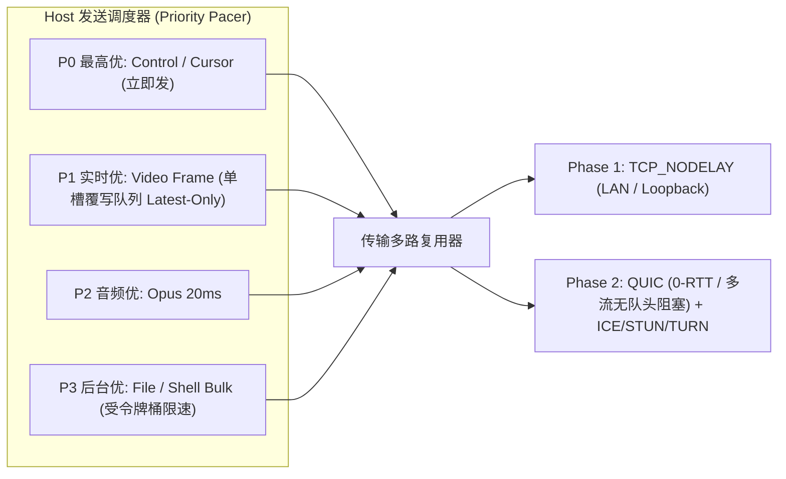

# 模块详细设计 01：协议规范与传输层（`core-protocol` & `core-transport`）

> 对应 Clean-Room 架构的通信底座：定义所有跨进程、跨网络与跨语言（C#/Rust/Node MCP）共享的二进制帧协议、多路复用通道、低延迟背压策略，以及从 Phase 1（TCP/LAN）平滑演进到 Phase 2（QUIC/WebRTC + ICE/TURN）的传输抽象。

---

## 1. 二进制线协议设计（Wire Protocol v1）

采用**固定 16 字节大端/小端统一小端帧头（Little-Endian）+ 变长载荷**，确保零歧义拆包、极低序列化开销，且易于在 C#、Rust、C++、Node.js 中一致实现。

### 1.1 通用外层帧头（16 Bytes）

```text
 0       1       2       3       4       5       6       7
+-------+-------+-------+-------+-------+-------+-------+-------+
|     Magic ('C','T','D','1')   |  Ver  | Type  | Flags | ChId  |
+-------+-------+-------+-------+-------+-------+-------+-------+
|                         PayloadLength (u32)                   |
+-------+-------+-------+-------+-------+-------+-------+-------+
|                           SeqId (u32)                         |
+-------+-------+-------+-------+-------+-------+-------+-------+
|                     Payload (PayloadLength bytes)             |
+---------------------------------------------------------------+
```

| 字段 | 类型 | 说明 |
| :--- | :--- | :--- |
| `Magic` | `[u8; 4]` | 固定 `0x43 0x54 0x44 0x31`（`"CTD1"`），快速校验非法流 |
| `Ver` | `u8` | 协议版本，当前为 `1` |
| `Type` | `u8` | 消息类型（见下表） |
| `Flags` | `u8` | 位标志：`bit0=KeyFrame`，`bit1=LosslessRefinement`，`bit2=Compressed` |
| `ChId` | `u8` | 逻辑通道 ID：`0=Control`，`1=Video`，`2=Cursor`，`3=Input`，`4=Audio`，`5=File` |
| `PayloadLength` | `u32` | 后续载荷字节数（单帧硬上限 16 MB，防止恶意 OOM） |
| `SeqId` | `u32` | 按通道单调递增序号，用于丢包检测、乱序丢弃与端到端时延关联 |

### 1.2 消息类型（`MsgType`）

| Code | 名称 | 方向 | 通道 | 载荷定义 |
| :--- | :--- | :--- | :--- | :--- |
| `0x01` | `Hello` | Client → Host | `0` | JSON：`{ clientName, token, capabilities, maxFps, quality }` |
| `0x02` | `HelloAck` | Host → Client | `0` | JSON：`{ sessionId, width, height, tileSize, captureBackend, inputEnabled, codecProbe }` |
| `0x03` | `Ping` | 双向 | `0` | `timestampUs (u64)` |
| `0x04` | `Pong` | 双向 | `0` | `originTimestampUs (u64) + serverTimestampUs (u64)` |
| `0x10` | `VideoTileFrame` | Host → Client | `1` | 复合脏块视频帧（见 1.3） |
| `0x11` | `RequestKeyFrame` | Client → Host | `0` | `reason (u8)`：首帧、分辨率变更或缓存帧异常（对应 `PLI/FIR`） |
| `0x12` | `VideoBitStream` | Host → Client | `1` | (Phase 2) H.264/HEVC/AV1 Annex-B NAL 单元帧 |
| `0x20` | `CursorState` | Host → Client | `2` | `x(i32), y(i32), visible(u8), shapeHash(u64), hotspotX(u16), hotspotY(u16), w(u16), h(u16), rgbaLen(u32), [rgba]` |
| `0x30` | `MouseEvent` | Client → Host | `3` | `action(u8: Move/Down/Up/Wheel), button(u8), normX(u16: 0..65535), normY(u16: 0..65535), wheelDelta(i16)` |
| `0x31` | `KeyEvent` | Client → Host | `3` | `action(u8: Down/Up/Char), vk(u16), scanCode(u16), flags(u16), unicodeChar(u32)` |
| `0x40` | `ScreenshotReq` | Client/MCP → Host | `0` | `maxWidth(u16), quality(u8), format(u8: 0=JPEG, 1=PNG)` |
| `0x41` | `ScreenshotResp` | Host → Client/MCP | `0` | `origW(u16), origH(u16), outW(u16), outH(u16), format(u8), dataLen(u32), [imgBytes]` |

### 1.3 复合脏块视频帧（`VideoTileFrame`, `0x10`）二进制结构

用于 Phase 1 即刻跑通“**运动区有损高帧率 + 静止文字区无损补清晰**”的复合帧管线：

```text
Header (24 bytes):
  captureTsUs : u64   // 采集高精度时间戳 (微秒)
  frameId     : u32   // 全局帧序号
  screenW     : u16   // 桌面宽
  screenH     : u16   // 桌面高
  tileSize    : u16   // 分块尺寸 (默认 128)
  tileCount   : u16   // 本帧包含的脏块数量 (0 表示屏幕静止心跳)
  encodeUs    : u32   // Host 端本帧编码耗时 (微秒，用于性能观测)

Repeated Tile[tileCount]:
  x           : u16   // 像素 X 坐标
  y           : u16   // 像素 Y 坐标
  w           : u16   // 块宽 (边界块可能 < tileSize)
  h           : u16   // 块高
  encoding    : u8    // 0=RawBGRA, 1=JPEG(有损快速层), 2=PNG(无损清晰层)
  flags       : u8    // bit0=RefinementPass (静止补清帧)
  dataLen     : u32   // 块压缩字节数
  data        : [u8; dataLen]
```

---

## 2. 传输层架构与低延迟背压策略（`core-transport`）

### 2.1 四条逻辑通道与优先级调度



### 2.2 远控防延迟膨胀（Anti-Bufferbloat）三大铁律
1. **关闭 Nagle 算法**：Phase 1 TCP 必须设置 `TCP_NODELAY = true`，并限制内核发送缓冲区（如 256 KB），避免积压 10 帧产生 300ms 拖影。
2. **视频队列采用 Latest-Only 覆写语义**：当网络拥塞导致上一帧尚未发出时，**绝不排队堆积视频帧**，而是合并脏区并优先发出最新帧；一旦丢弃非关键帧导致参考链断裂（H.264 阶段），立刻触发下一帧强制 IDR。
3. **光标与视频完全解耦**：光标坐标包（17~25 字节）走独立高优队列 `ChId=2`，即便视频帧正在传输或拥塞，光标依然能以 60~120Hz 丝滑响应。

### 2.3 Phase 2 公网穿透演进接口（预留抽象）
```csharp
public interface ITransportChannel : IDisposable
{
    bool IsConnected { get; }
    Task SendFrameAsync(FrameHeader header, ReadOnlyMemory<byte> payload, CancellationToken ct);
    Task<(FrameHeader Header, byte[] Payload)?> ReadFrameAsync(CancellationToken ct);
}
```
- **Phase 1**：`TcpTransportChannel`（局域网 / 回环直连）。
- **Phase 2**：`QuicTransportChannel` / `WebRtcTransportChannel`，配合 WebSocket 信令服完成 SDP/ICE Candidate 交换，优先 P2P UDP 打洞，企业严格对称 NAT 下自动切 `coturn` TURN 中继，并在传输层叠加 E2EE 会话密钥（X25519 + AES-256-GCM）。
