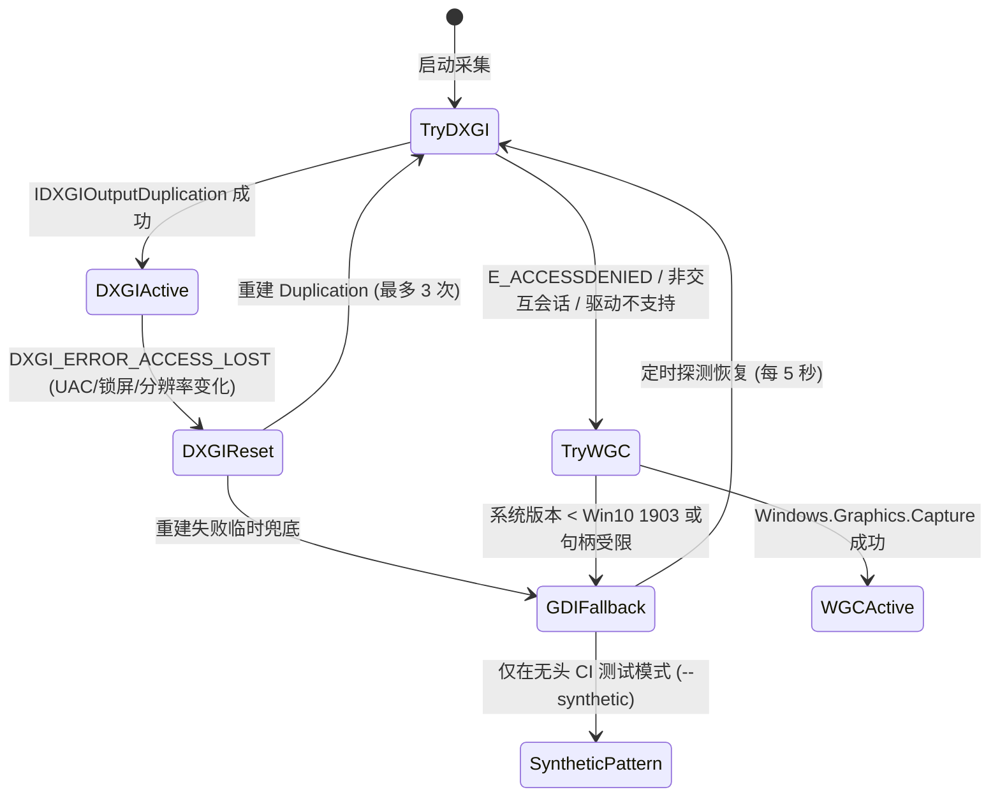
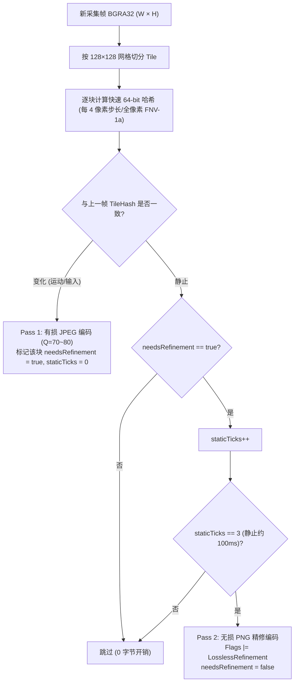

# 模块详细设计 02：采集、复合编码、硬件探针与低延迟渲染

> 对应 Clean-Room 架构的媒体管线（对标 `zrtc.dll` + `codec_checker.exe` 的核心工程抽象），重点解决三个远控核心痛点：**高帧率低 CPU 采集**、**动态流畅 + 静止文字锐利**、**显卡驱动异常隔离**。

---

## 1. 三级屏幕采集状态机（`core-capture`）

### 1.1 采集策略降级链



### 1.2 关键采集接口抽象
```csharp
public interface IScreenCapturer : IDisposable
{
    string BackendName { get; }          // "DXGI-DD" | "GDI-BitBlt" | "Synthetic"
    int Width { get; }
    int Height { get; }
    /// 抓取最新一帧 BGRA32 到调用方复用的缓冲区，返回是否发生画面变化
    bool TryCaptureBgra(byte[] targetBuffer, out long captureTsUs);
}
```

### 1.3 光标独立采集器（`ICursorCapturer`）
- 以独立高频率（120Hz 或每 8ms）轮询 `user32.dll!GetCursorInfo`。
- 维护 `(lastX, lastY, lastVisible, lastHCursor)` 缓存：
  - 仅位置变化：发送 25 字节轻量 `CursorState` 包（`rgbaLen = 0`）。
  - 指针形状（`hCursor`）变化：通过 `GetIconInfo` + `GetDIBits` 提取 RGBA 位图与热点 `(hotspotX, hotspotY)`，计算 FNV-1a 64-bit `shapeHash`，命中客户端缓存则不再重传位图。

---

## 2. 复合帧编码与静止无损补清（`core-codec`）

对标 `zrtc.dll` 的 `[COMPOUND_DECODE_FRAME]`（`lossy_done` → `lossless_done`）机理，Phase 1 用**双阶段分块复合编码器**实现同等产品体验，Phase 2 可无缝叠加 H.264/HEVC 视频流底层：

### 2.1 分块脏区与复合编码状态机



### 2.2 为什么这套机制在远控场景极其有效？
- **拖动窗口 / 播放视频时**：仅变化区域走高速 JPEG（单 128×128 块编码耗时 < 0.2ms，压缩比 15:1~30:1），帧率拉满且带宽可控。
- **停手看代码 / 看 Excel 表格时**：100ms 后自动对刚变化过的文字块补发一次**无损 PNG 精修块**，消除全部 JPEG 蚊式噪点与色度子采样发虚；随后屏幕完全静止时带宽降至 **0 KB/s**。
- **Phase 2 演进**：将 Pass 1 替换为 `NVENC/AMF/QSV` H.264/HEVC 硬件编码（D3D11 Compute Shader 显存直转 NV12，0 CPU 拷贝），Pass 2 保留 ROI 无损补清层（`CompositeEncoder`）。

---

## 3. 独立子进程硬件编解码探针（`CopyToDesk.CodecProbe.exe`）

完全借鉴 `codec_checker.exe` 的故障隔离模式：
- **为什么必须独立进程**：显卡驱动初始化 `D3D11CreateDevice`、`IDXGIOutputDuplication` 或枚举硬件 Media Foundation MFT 编码器时，在双显卡笔记本/老旧驱动机器上存在挂死或触发原生 `AccessViolationException`（进程内 `try/catch` 无法捕获）的风险。
- **执行契约**：
  1. Host 启动时以 3 秒超时拉起 `CopyToDesk.CodecProbe.exe --json`。
  2. 探针依次检测：
     - DXGI 物理显卡列表（Adapter Description、VendorId：`0x10DE=NVIDIA` / `0x1002=AMD` / `0x8086=Intel`、DedicatedVideoMemory）。
     - D3D11 硬件设备可用性（`D3D_DRIVER_TYPE_HARDWARE`）。
     - 是否可创建 `IDXGIOutputDuplication`（检验当前会话是否支持零拷贝桌面复制）。
     - Windows Media Foundation 硬件 H.264/HEVC 编码器存在性检测（`MFTEnumEx`）。
  3. 输出结构化 JSON 能力清单，Host 据此自动选择最优采集与编码后端；若探针异常退出或超时，Host 自动降级安全模式（`GDI-BitBlt` + 软件编码）。

---

## 4. 低延迟解码与渲染管线（`core-render`）

### 4.1 渲染端双缓冲合成架构
- **持久化帧缓冲（Persistent Framebuffer）**：Viewer 维护一块与远端桌面等尺寸的 `BGRA32` / GPU 纹理画布；每收到一帧 `VideoTileFrame`，只局部更新变化矩形区域，避免全屏重绘。
- **独立光标层（Hardware / Overlay Cursor）**：光标不烘焙在视频帧中，而是根据 `ChId=2` 的 `CursorState` 实时绘制在顶层（或直接设置为本地原生窗口光标句柄），实现接近 0ms 的指针跟手度。
- **无撕裂与低排队**：
  - Phase 1（WinForms）：开启 `DoubleBuffered` + `UserPaint` + 独立网络解码线程向前端提交脏矩形 `Invalidate(dirtyBounds)`，附带实时 HUD 叠层（FPS / RTT / 带宽 / 复合帧有损&无损计数）。
  - Phase 2（D3D11）：升级为 `IDXGISwapChain1`（`DXGI_SWAP_EFFECT_FLIP_DISCARD` + `DXGI_SWAP_CHAIN_FLAG_FRAME_LATENCY_WAITABLE_OBJECT` + `SetMaximumFrameLatency(1)`），把呈现队列严格压死在 1 帧以内。
