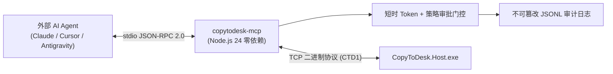

# 模块详细设计 03：输入注入、虚拟显示器与 AI MCP 安全治理

> 对应 Clean-Room 架构的控制与自动化平面（对标 `vHIDEx`、`libvdm`、`zagent_shared.dll` 与 `todesk-mcp.exe` 的核心工程设计）。

---

## 1. 键鼠输入注入子系统（`core-input`）

### 1.1 坐标归一化与多屏映射
- 客户端所有鼠标坐标统一归一化到 `[0, 65535]`（无符号 16 位整数），直接对齐 Windows `SendInput` 的 `MOUSEEVENTF_ABSOLUTE | MOUSEEVENTF_VIRTUALDESK` 坐标空间，彻底消除高 DPI 缩放（125%/150%/200%）导致的点击偏移。

### 1.2 两阶段输入后端设计
```csharp
public interface IInputInjector
{
    string BackendName { get; }  // "Win32-SendInput" | "DryRun-Audit" | "WDK-VHF-HID"
    void InjectMouse(MouseAction action, MouseButton button, ushort normX, ushort normY, short wheelDelta);
    void InjectKey(KeyAction action, ushort vk, ushort scanCode, ushort flags, uint unicodeChar);
}
```

| 阶段 | 实现方案 | 适用场景与边界 |
| :--- | :--- | :--- |
| **Phase 1 (MVP)** | `Win32-SendInput` + 默认安全开关（`--allow-input` 开启，否则走 `DryRun-Audit` 仅记录日志不干扰本机） | 常规桌面应用、浏览器、IDE、终端；作为 Windows Service 运行时可通过 `OpenInputDesktop` + `SetThreadDesktop` 切入 UAC/锁屏桌面 |
| **Phase 2 (进阶)** | 基于微软官方 WDK **VHF (Virtual HID Framework)** 的虚拟键鼠驱动 | 解决 `LLMHF_INJECTED` 标志拦截，支持反作弊/3D FPS 相对位移鼠标与硬件级手写笔/触控注入 |

---

## 2. 虚拟显示器控制层设计（`core-vdisplay`，Phase 2 预留）

借鉴 `libvdm.dll` + `ToDeskVDM.dll` 的生产实践，设计 4 个关键契约（避免踩坑）：

1. **驱动形态**：基于微软开源 WDK `IddCx`（Indirect Display Driver Class Extension）UMDF 2.0 样本构建，运行在用户态驱动宿主（`WUDFHost.exe`），崩溃不会引起系统蓝屏。
2. **自定义 EDID 注入**：Host 根据控制端上报的 `(width, height, refreshRate)` 动态构造 128/256 字节标准 EDID（含有效校验和），通过 `DeviceIoControl` 下发给驱动热插拔出精确匹配的虚拟屏幕。
3. **强制心跳看门狗（防幽灵屏核心）**：
   - 控制库每 2 秒发送一次 `IOCTL_VDM_HEARTBEAT`。
   - 若驱动超过 8 秒未收到心跳（如 Host 崩溃或强杀），驱动内部定时器自动调用 `IddCxMonitorDeparture` 拔出所有虚拟显示器，确保用户物理桌面立刻恢复正常。
4. **多屏拓扑与隐私屏恢复**：借助 Windows CCD API（`QueryDisplayConfig` / `SetDisplayConfig`）保存连接前的显示拓扑快照，会话断开或进程退出时无条件回滚。

---

## 3. AI Agent / MCP Server 体系设计（`mcp-server`）

借鉴 `todesk-mcp.exe` 的模块化工具集与 `zagent_shared.dll` 的安全治理机制，设计独立的零依赖 **MCP Server（JSON-RPC 2.0 over stdio）**：

### 3.1 架构分层



### 3.2 MVP 核心 MCP 工具集（首批落地与扩展规划）

| 工具名 | 风险等级 | 说明 | Phase 1 状态 |
| :--- | :--- | :--- | :--- |
| `remote_screen_info` | 只读 | 获取远端屏幕分辨率、采集后端、输入开关与显卡能力 | ✅ Phase 1 实现 |
| `remote_screenshot` | 只读 | 抓取当前桌面并返回 base64 JPEG/PNG 图像与原始坐标尺寸 | ✅ Phase 1 实现 |
| `remote_click` | 写操作 | 按像素坐标移动并点击（左/右/中键、单击/双击） | ✅ Phase 1 实现 |
| `remote_move_drag` | 写操作 | 鼠标移动或按住拖拽 | ✅ Phase 1 实现 |
| `remote_scroll` | 写操作 | 鼠标滚轮滚动 | ✅ Phase 1 实现 |
| `remote_type` | 写操作 | 输入 Unicode 文本字符串 | ✅ Phase 1 实现 |
| `remote_hotkey` | 写操作 | 组合键输入（如 `Ctrl+C`, `Alt+Tab`, `Enter`） | ✅ Phase 1 实现 |
| `remote_exec` | 高危写 | 受白名单与人工审批门控的远程命令执行 | Phase 2 扩展 |
| `remote_file_upload` | 高危写 | 带 SHA-256 校验与路径白名单的文件上传 | Phase 2 扩展 |
| `remote_file_download` | 中危读 | 受路径白名单保护的文件下载 | Phase 2 扩展 |

### 3.3 安全护栏设计（默认安全原则）
1. **默认最小权限**：Host 默认仅监听 `127.0.0.1` 且 `--allow-input` 默认关闭（或需显式传入会话 Token），防止局域网未授权接入。
2. **短时动态 Token**：每次启动 Host 自动生成 256-bit 随机 `sessionToken`（支持 `--token` 指定，用于自动化测试/本地联动），连接握手 `Hello` 校验失败立即断开。
3. **全链路操作审计**：MCP Server 对每一次 `tools/call` 记录 `{ ts, tool, argsSummary, allowed, latencyMs, resultStatus }` 到本地 `logs/mcp-audit.jsonl`，便于事后复盘与回溯。
