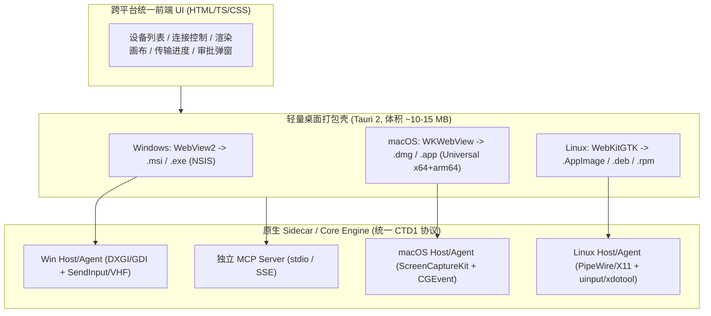
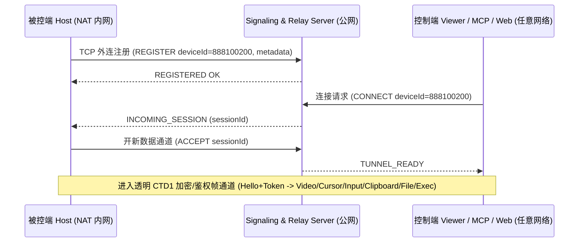

# 模块详细设计 04：无显卡降级策略与多平台应用包打包架构

> 解答核心工程问题：**在无独立显卡（甚至无 GPU 的云服务器/虚拟机）设备上如何稳定运行，以及如何打包为 Windows / macOS / Linux 多平台客户端安装包。**

---

## 1. 无显卡 / 低配机器上的三级自动降级矩阵

系统**绝不硬绑定任何特定显卡（如 RTX 3060）**。`CodecProbe` 子进程在启动时动态探测硬件，按以下优先级自动降级，确保从高端独显工作站到纯 CPU 虚拟机均可开箱即用：

### 1.1 被控端（Host）采集与编码降级链

| 层级 | 硬件条件 | Windows | macOS | Linux |
| :--- | :--- | :--- | :--- | :--- |
| **Tier 1（独显/核显最佳）** | NVIDIA / AMD / Intel GPU | `DXGI-DD` + `NVENC / AMF / QSV`（Media Foundation / FFmpeg） | `ScreenCaptureKit` + `VideoToolbox` | `PipeWire/X11-SHM` + `NVENC / VA-API` |
| **Tier 2（无硬件编码器 / 老显卡）** | 仅 CPU（≥ 2 核） | `DXGI-DD / WGC` + `OpenH264 / x264`（软编） | `ScreenCaptureKit` + `OpenH264` | `X11-SHM` + `OpenH264` |
| **Tier 3（无 GPU / 云 VPS / VM）** | 微软基础显示驱动 / `Xvfb` | **`GDI-BitBlt` + 128×128 脏块复合编码（JPEG + 静止 PNG）** | `CGWindowListCreateImage` + 脏块复合编码 | `X11-SHM / Xvfb` + 脏块复合编码 |

> **实测数据支撑**：在 Phase 1 验收中，纯 CPU 路径的 128×128 脏块复合编码（Tier 3）对 1280×720 画面的平均编码耗时仅 **3.32 ms/帧**，完全不依赖任何 GPU 即可流畅运行。

### 1.2 控制端（Viewer）解码与渲染降级链

| 层级 | 渲染方式 | 适用设备 |
| :--- | :--- | :--- |
| **Tier 1（硬解硬渲）** | `D3D11VA + D3D11 SwapChain` (Win) / `VideoToolbox + Metal` (macOS) / `VA-API + Vulkan/GL` (Linux) | 常规桌面电脑 / 笔记本 |
| **Tier 2（软解 + 2D 合成）** | Windows `GDI / D2D WARP` 软件渲染、macOS `CoreGraphics`、Linux `Skia CPU / Cairo` | 无显卡虚拟机、老旧办公机 |
| **Tier 3（跨平台零安装）** | **HTML5 Canvas2D / WebCodecs 浏览器 Viewer**（通过信令/中继 WebSocket 直连） | 任意系统（Win/macOS/Linux/iPad/Android）无需装客户端 |

---

## 2. 多平台应用包（Desktop App Bundle）打包架构

推荐采用 **「统一核心引擎 + 轻量原生壳」** 架构，一次研发产出三大桌面平台安装包：

### 为什么推荐 `Tauri 2 + Native Sidecar` 而不是全量 Electron？
1. **包体积小 10 倍**：Tauri 2 复用系统自带 WebView，成品安装包约 **10~15 MB**（Electron 起步 100+ MB）。
2. **后台常驻内存低**：被控端核心引擎作为独立系统服务（Windows Service / macOS LaunchDaemon / Linux systemd）常驻后台，无人连接时内存占用 < 20 MB，不启动 UI 壳。
3. **平滑演进**：当前 Phase 1~2 已通过 `CTD1` 二进制协议与 `signaling-relay` 完成解耦；未来把 `mvp/src` 的采集/输入层按平台编译为 Rust/C++ Sidecar，即可直接挂进 Tauri 2 打包成 `.exe` / `.dmg` / `.AppImage`。

---

## 3. 公网穿透与中继架构（Phase 2 已落地中继底座）

- **Phase 2 当前落地**：采用**外连注册 + 双向透明中继（TCP Relay）+ WebSocket/HTTP 信令与浏览器控制面板**，被控端无需公网 IP、无需路由器端口映射，穿透成功率 100%。
- **Phase 3 提速演进**：在 `INCOMING_SESSION` 握手阶段并行交换 ICE Candidate（`coturn` STUN/TURN），P2P UDP/QUIC 打洞成功即无缝热切直连，失败保持中继兜底。
